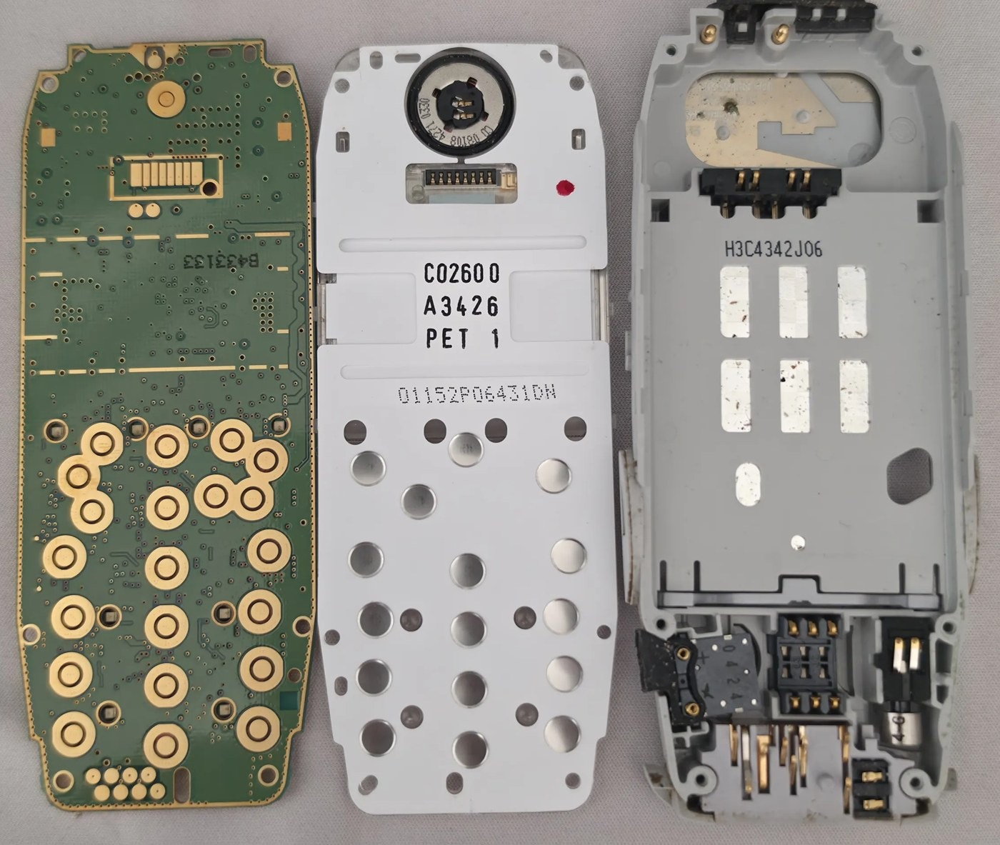
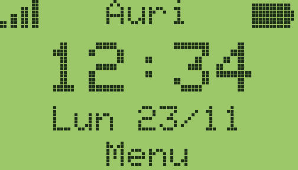

# Nokia Auri-3310

[English](README.md) | Italiano

Avevo un Nokia 3310 in un cassetto. Funzionava ancora, come tutti i 3310. Invece di lasciarlo lì ho deciso di aprirlo e dargli un cervello nuovo.

L'idea è semplice da dire e un po' meno da fare: togliere la scheda madre originale e metterne al suo posto una progettata da zero, con un ESP32-S3. Scocca, display, tasti, altoparlante e vibrazione restano quelli del 2000. Il telefono si accende, si collega al Wi-Fi, controlla casa tramite Home Assistant e, soprattutto, ha dentro una shell con cui parlare con Claude.



## A che punto siamo

Il telefono è smontato e fotografato. Ho studiato la scheda e scritto il [piano di progetto](docs/Nokia_Auri-3310_Piano_Maestro_v2_0.docx). Il software è partito: Auri OS è scritto in MicroPython e gira già in un simulatore sul PC, con menu, scrittura T9 e il primo gioco. Le scansioni 1:1 della scheda sono in `docs/scans`.



Per provarlo serve solo Python 3:

```
cd firmware
python sim.py
```

Non esiste ancora nessuna PCB. Se cerchi qualcosa da saldare stasera, è troppo presto. Se vuoi dare una mano, è il momento giusto.

## Cosa ho scoperto aprendolo

Un paio di cose mi hanno reso la vita molto più facile del previsto.

**La tastiera non ha un connettore.** I tasti chiudono degli anelli dorati disegnati direttamente sulla scheda madre, tramite cupolette metalliche incollate su un foglio di plastica. Alla nuova scheda basta avere gli stessi anelli nella stessa posizione.

**Il display è appoggiato, non saldato.** Si collega con otto contattini a molla. Il controller è il classico PCD8544, lo stesso dei moduli "Nokia 5110" che si comprano per pochi euro, quindi il software si può scrivere senza toccare l'originale.

**Metà della scheda è schermatura radio.** Senza modem GSM non serve più, e quello spazio è proprio quello che serve per l'ESP32.

La scheda è revisione `UB4_12`, codice `9854424`, modello `NHM-5NX`. La scheda originale non viene modificata: la conservo intera.

## Cosa farà

Un piccolo sistema operativo, Auri OS, pensato per un display da 84x48 pixel: orologio, menu, scrittura T9, qualche gioco (sì, anche un serpente, fatto da me).

Un'app per la casa: luci, prese, scene e sensori di Home Assistant, dal tastierino.

E la parte che mi diverte di più: **la shell Claude**. Scrivi in T9, oppure tieni premuto il tasto grande sotto lo schermo e parli. Il telefono manda la richiesta a un piccolo server sul Raspberry Pi di casa, che chiama Claude e gli permette di usare solo gli strumenti che ho deciso io. Quando Claude vuole fare qualcosa, per esempio spegnere le luci o controllare un server, il telefono me lo chiede: il tasto grande conferma, C annulla.

```
 Nokia 3310            Raspberry Pi             fuori
 ESP32-S3  ---Wi-Fi--> Auri Bridge  ----------> Claude
 Auri OS   <---------  (Python)     ----------> Home Assistant
```

## Com'è organizzato

```
firmware/   Auri OS in MicroPython, più il simulatore per PC
bridge/     il server sul Raspberry Pi
hardware/   schema e PCB in KiCad
docs/       piano di progetto, foto, scansioni
```

## Roadmap

- [x] Smontaggio, foto, analisi della scheda
- [x] Simulatore per PC e interfaccia di base
- [ ] Bridge e shell Claude funzionanti nel simulatore
- [ ] Firmware su ESP32-S3 DevKit con un display 5110
- [ ] Test del display originale
- [ ] Scansione 1:1, contorno della scheda, misure di altezza
- [ ] Prima PCB in KiCad, prova su stampa
- [ ] Prima scheda montata dentro il telefono
- [ ] Più avanti: fotocamera su un fondello stampato in 3D

## Dare una mano

Mi farebbe piacere ricevere aiuto soprattutto in tre cose:

- PCB sottili e antenne a 2,4 GHz, la parte dove ho meno esperienza;
- misure e conferme da chi ha un 3310 aperto sul tavolo;
- pixel art per icone e giochi.

Apri una issue, anche solo per fare una domanda.

## Progetti da cui ho imparato

- [hoani/3310_pico](https://github.com/hoani/3310_pico), un Raspberry Pi Pico dentro il 3310
- [M17-Project/M17_3310](https://github.com/M17-Project/M17_3310), una scheda sostitutiva completa
- [Guida Adafruit al display 5110/3310](https://learn.adafruit.com/nokia-5110-3310-monochrome-lcd)

## Licenza

Software sotto MIT, hardware sotto CERN-OHL-S v2.
Nokia e 3310 sono marchi dei rispettivi proprietari. È un progetto personale, senza alcun legame con Nokia.

Luigi Califano
