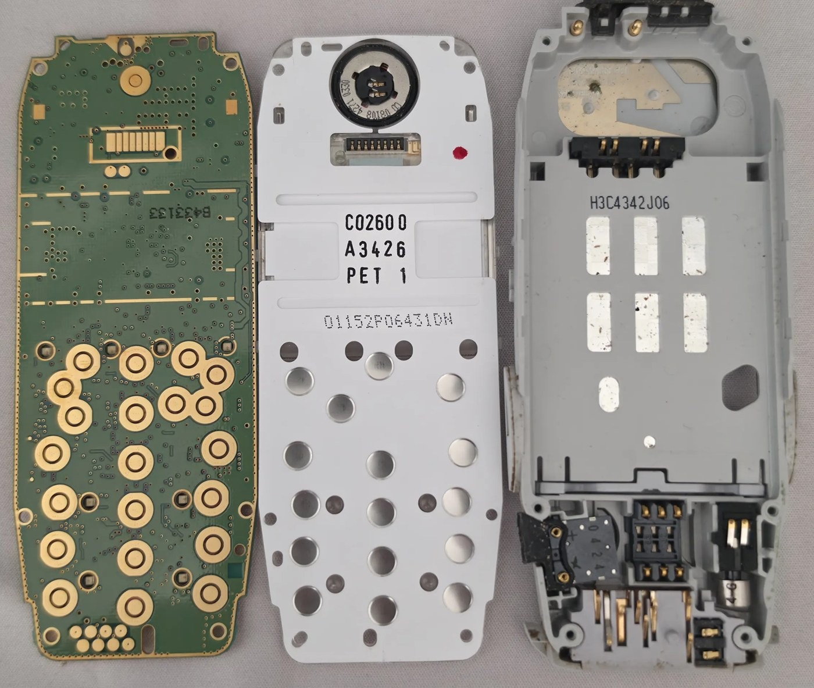
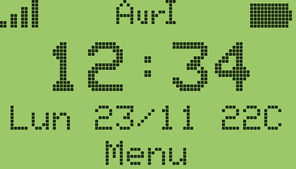
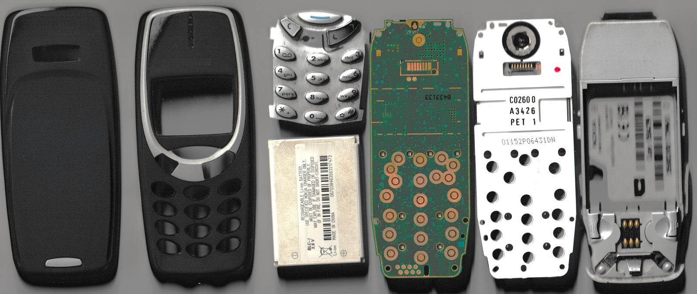
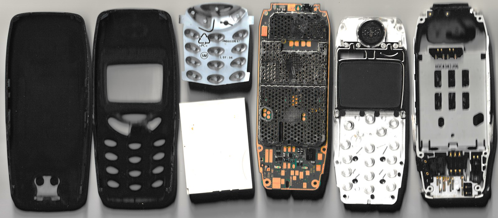

# AurI-3310

English | [Italiano](README.it.md)

I had a Nokia 3310 sitting in a drawer. It still worked, because of course it did. Instead of leaving it there, I opened it up to give it a new brain.

The plan is easy to say and harder to do: pull out the original mainboard and replace it with one designed from scratch around an ESP32-S3. The shell, screen, keys, earpiece, vibration motor and, if it tests well, the microphone all stay the ones from 2000. The phone boots, joins Wi-Fi, controls the house through Home Assistant and, best of all, carries a shell for talking to Claude.



## Where things stand

The phone is apart and photographed, I've studied the board and written the [project plan](docs/AurI-3310_Piano_Maestro_v2_0.docx) (in Italian for now). Software has started: AurI OS is written in MicroPython and already runs in a PC simulator, with menus, T9 typing and the first game. The 1:1 board scans are in `docs/scans`.



All you need to try it is Python 3:

```
cd firmware
python sim.py
```

There is no PCB yet. If you're looking for something to solder tonight, it's too early. If you'd like to help shape it, it's the right time.

## What I found inside

A few things turned out much friendlier than expected.

**The keypad has no connector.** Each key presses a metal dome onto a pair of gold rings printed directly on the mainboard. The new board just needs the same rings in the same places.

**The display isn't soldered.** It sits on eight tiny spring contacts. The controller is the familiar PCD8544, the same chip on the cheap "Nokia 5110" modules, so the software can be written without touching the original.

**Half the board is RF shielding.** With no GSM modem it's no longer needed, and that space is exactly where the ESP32 goes.

The board is revision `UB4_12`, code `9854424`, type `NHM-5NX`. The original board is kept intact, not modified.

## The original parts that stay

I put every piece on the scanner, front and back. The covers, the screen, the keymat, the earpiece, the vibration motor and the microphone are the ones that will go back into the phone. The old mainboard and the BLC-1 battery are in the picture too, but they're keepsakes now: they won't be powered again.





## What it will do

A small operating system, AurI OS, built for an 84x48 screen: clock, menus, T9 typing, a few games (yes, there's a snake, my own take on it).

A home app: lights, plugs, scenes and sensors from Home Assistant, right from the keypad.

An assistant of its own, **AurI**: hold the power key (or the big key on the home screen), ask something out loud and it answers in a sentence or two, out of the earpiece. Behind it sits Google Gemini on its free tier, and it can switch on the lights I've allowed. It's the quick, everyday voice of the phone.

And the part I'm most excited about: **the Claude shell**, a separate app with its own menu entry. Type with T9, or hold the big key inside the app and talk. The phone sends the request to a small server on the Raspberry Pi at home, which calls Claude and lets it use only the tools I've allowed. Whenever Claude wants to actually do something, like turning off the lights or checking a server, the phone asks first: the big key confirms, C cancels.

```
 Nokia 3310            Raspberry Pi             outside
 ESP32-S3  ---Wi-Fi--> AurI Bridge  ----------> Claude, Gemini
 AurI OS   <---------  (Python)     ----------> Home Assistant
```

## Layout

```
firmware/   AurI OS in MicroPython, plus the PC simulator
bridge/     the server running on the Raspberry Pi
hardware/   KiCad schematic and PCB
docs/       project plan, photos, scans
```

## Roadmap

- [x] Teardown, photos, board analysis
- [x] PC simulator and basic UI
- [ ] Bridge and Claude shell working in the simulator
- [ ] Firmware on an ESP32-S3 DevKit with a 5110 display
- [ ] Testing the original display
- [ ] 1:1 scan, board outline, height measurements
- [ ] First KiCad PCB, paper fit check
- [ ] First board inside the phone
- [ ] Later: a camera on a 3D printed back cover

## Helping out

I'd especially welcome help with:

- thin PCBs and 2.4 GHz antennas, where I have the least experience;
- measurements and confirmations from anyone with an open 3310 on their desk;
- pixel art for icons and games.

Open an issue, even just to ask something.

## Projects I learned from

- [hoani/3310_pico](https://github.com/hoani/3310_pico), a Raspberry Pi Pico inside a 3310
- [M17-Project/M17_3310](https://github.com/M17-Project/M17_3310), a full replacement mainboard
- [Adafruit guide to the 5110/3310 display](https://learn.adafruit.com/nokia-5110-3310-monochrome-lcd)

## License

Software under MIT, hardware under CERN-OHL-S v2.
Nokia and 3310 are trademarks of their respective owners. This is a personal project with no connection to Nokia.

Luigi Califano
